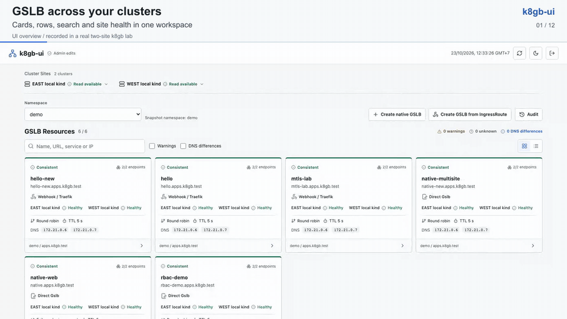
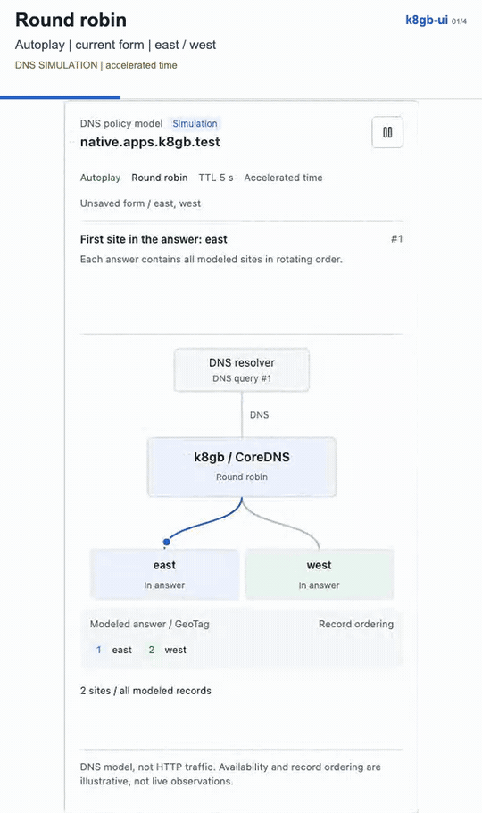

# k8gb-ui

Standalone multi-cluster console for k8gb, read-only by default. Manage native
Gslb resources or use the optional Traefik IngressRoute adapter.
An independent project, not an official k8gb component. The 0.1.x release line
is a preview; review the deployment boundaries below before enabling writes.

## Choose a management mode

| Mode | What you manage in UI | What is created or updated | When to use it |
| --- | --- | --- | --- |
| **Native Gslb** | A standalone k8gb `Gslb` and its DNS policy | UI creates a `Gslb` referencing an existing Ingress or HTTPRoute, or edits its policy | You already use native Kubernetes routing and want no additional webhook |
| **Traefik webhook** | An existing Traefik `IngressRoute` and its GSLB settings | UI updates the source annotations; the optional reconciler creates and maintains the global Ingress, Gslb and optional authorization Middleware | Your application routes are IngressRoutes and you do not want to maintain the extra k8gb-facing resources by hand |

**Why the webhook?** Select **Create GSLB from IngressRoute**, choose the DNS name,
sites and policy, then preview and apply. The adapter derives the DNS-facing
resources from the source route; you do not directly edit its generated Gslb.
k8gb still performs health evaluation and DNS publication. The adapter does not
replace k8gb, Traefik, application Services, certificates or DNS delegation.

Native mode needs no k8gb-ui webhook, even if Traefik happens to be your ordinary
Ingress controller. Both modes can coexist for different objects; direct editing
of webhook-owned Gslbs is blocked. Automatic native-to-webhook migration is not
implemented. See [management workflows and boundaries](docs/deployment-options.md#management-modes).

## Choose a deployment topology

Console is the web UI; each participating cluster has its own agent.
**UI placement and management mode are independent choices.**

| Topology | Placement | Public UI address |
| --- | --- | --- |
| **A. One Console, many agents** | Console in one cluster, agents in every participating cluster | One HTTPS UI endpoint; Console can have multiple replicas in that cluster |
| **B. Distributed Consoles, many agents** | Console and agent in each selected site; every Console connects to every agent | The same HTTPS hostname can be published through k8gb/GSLB across the Console sites |

Either topology works **with or without** the Traefik webhook. Distributed
Consoles share authentication configuration and the cookie-signing key, not a
desired-state database. Agents keep distinct per-cluster URLs and credentials;
audit is aggregated from their per-site journals. The chart does not automatically
publish its own UI through GSLB or replicate Secrets between clusters.

See [topology diagrams, the four combinations and shared-hostname setup](docs/deployment-options.md).

## Demo

A two-site tour with real k8gb, DNS and Traefik:

- Create and manage native Gslbs or use the optional IngressRoute webhook.
- Preview changes across clusters, exclude and restore sites, override and reset IPs.
- Configure mTLS and DNS SAN authorization, scope access with RBAC, and inspect audit history.

### Interface overview



**40-second interface tour:** 12 scenes covering native and IngressRoute creation,
policy editing and previews, site/IP controls, mTLS, audit, namespace-scoped access
and themes. Recorded from the real two-site lab, with English captions and an
automatic loop.

[Watch the full demo](docs/media/k8gb-ui-demo.mp4) (2:40, 1080p, English captions, no audio)
or browse the [chapter list](docs/media/chapters.md). The full demo also includes
real DNS, certificate and access-control checks.

### DNS policy animation



**Animated DNS policies:** round robin, weights, failover/recovery and GeoIP.
This separate GIF focuses on the DNS models; it is illustrative, not live traffic
telemetry.

## Install in Kubernetes

This is a **complete first-install walkthrough**: one Console in east, an agent
in east and west, built-in login, and **read-only access**. It uses published
images and the chart at **<https://steemax.github.io/k8gb-ui/>**; no image build
or Keycloak is required. The Traefik webhook is disabled.

```text
Browser -> Console in east -> east-agent -> east Kubernetes API
                          -> west-agent -> west Kubernetes API
```

Run the steps in order. Helm does **not** generate passwords, tokens or TLS
certificates: you create their Secrets below before installing the chart.
For an existing installation, preserve credentials and use the
[upgrade instructions](docs/installation.md#7-verify-and-upgrade-safely), not the
first-install generation commands.

### 1. Choose endpoints and prepare the workspace

You need working k8gb/CRDs in both clusters, the existing application namespace
`catalog`, and an ingress controller or TLS proxy. On your workstation install
`kubectl`, Helm, OpenSSL, Git and Go 1.26.10+; Go is used only to generate built-in
password hashes, not to build images or run anything in the clusters.

Replace the following example names **everywhere in the commands and YAML**:

| Example | Your value |
| --- | --- |
| `east`, `west` | Unique cluster IDs; this example also uses these as k8gb GeoTags |
| `catalog` | An existing application namespace to view |
| `apps.example.test` | A zone already served by your k8gb installation |
| `east-agent.example.test` | Dedicated HTTPS endpoint reaching only the east agent |
| `west-agent.example.test` | Dedicated HTTPS endpoint reaching only the west agent |
| `gslb.apps.example.test` | HTTPS Console endpoint, pointing to east for this walkthrough |
| `your-ingress-class` | Your existing IngressClass |

Provision the three endpoint DNS names and matching server certificates through
your existing PKI/certificate manager. This chart does not configure DNS
delegation, install an ingress controller or issue certificates. Every Console
must reach every agent; the two agent URLs must not be a shared round-robin
address. Restrict agent ingress/backend access to trusted Console traffic.

Choose contexts from `kubectl config get-contexts`. `PRIVATE` is a **workstation
directory outside Git**, not a path inside a pod:

```sh
export EAST_CONTEXT=your-east-context
export WEST_CONTEXT=your-west-context
export PRIVATE="$HOME/.config/k8gb-ui-install"
# Keep Console only in east when following the later upgrade guide.
export CONSOLE_IN_WEST=false
umask 077
mkdir -p "$PRIVATE/east" "$PRIVATE/west"
chmod 700 "$PRIVATE"

kubectl --context "$EAST_CONTEXT" get namespace catalog k8gb
kubectl --context "$WEST_CONTEXT" get namespace catalog k8gb
kubectl --context "$EAST_CONTEXT" create namespace k8gb-ui
kubectl --context "$WEST_CONTEXT" create namespace k8gb-ui

helm repo add k8gb-ui https://steemax.github.io/k8gb-ui/
helm repo update k8gb-ui
helm search repo k8gb-ui/k8gb-ui --versions
```

Skip a `create namespace` command if that namespace already exists. If your k8gb
Deployment is not `k8gb/k8gb`, adjust `agent.controller` in step 5.

### 2. Generate credentials once

These credentials have different purposes:

| File | Used for | Shared with |
| --- | --- | --- |
| `east/token`, `west/token` | Console authenticates read requests to that agent | The matching agent and every Console, never another site's agent |
| `east/write-token`, `west/write-token` | Separate administrator mutation credential | The matching agent and writable Consoles |
| `east/plan-key`, `west/plan-key` | Agent signs short-lived mutation plans | Only replicas of that same agent; never Console |
| `session-key` | Console signs login/session cookies | All Console replicas/sites serving the same UI |
| `users.yaml` | Built-in users with password hashes | All Console replicas/sites using those accounts |

Generate distinct agent credentials, plus a Console session key. Write/plan keys
are prepared for an optional later upgrade; **their presence does not enable
writes**. Do not rerun this block on upgrades or overwrite existing key files:

```sh
for site in east west; do
  openssl rand -hex 32 > "$PRIVATE/$site/token"
  openssl rand -hex 32 > "$PRIVATE/$site/write-token"
  openssl rand -hex 32 > "$PRIVATE/$site/plan-key"
done
openssl rand 32 > "$PRIVATE/session-key"
```

Generate two password hashes using the project helper. It prompts without echo
and asks for confirmation; use passwords of at least 12 bytes. No password is
passed on the command line:

```sh
git clone https://github.com/steemax/k8gb-ui.git "$PRIVATE/source"
go -C "$PRIVATE/source" run ./cmd/password-hash > "$PRIVATE/operator.hash"
go -C "$PRIVATE/source" run ./cmd/password-hash > "$PRIVATE/catalog-reader.hash"
```

Create `$PRIVATE/users.yaml`, replacing each placeholder with the **full single
line** from the matching `.hash` file, preserving the YAML quotes:

```yaml
users:
  - username: operator
    passwordHash: 'REPLACE_WITH_OPERATOR_ARGON2ID_HASH'
    groups: [platform-admins]
  - username: catalog-reader
    passwordHash: 'REPLACE_WITH_READER_ARGON2ID_HASH'
    groups: [team-catalog]
```

There is no default password. Agent bearer tokens are service credentials, not
Kubernetes ServiceAccount tokens or user login tokens.

### 3. Create TLS Secrets

Obtain the certificate/key files from your PKI. Replace the absolute paths below
with those existing files. Certificates must cover the corresponding endpoint
hostnames from step 1; use the full server certificate chain:

```sh
kubectl --context "$EAST_CONTEXT" -n k8gb-ui create secret tls agent-tls \
  --cert=/absolute/path/east-agent-fullchain.crt --key=/absolute/path/east-agent.key
kubectl --context "$WEST_CONTEXT" -n k8gb-ui create secret tls agent-tls \
  --cert=/absolute/path/west-agent-fullchain.crt --key=/absolute/path/west-agent.key
kubectl --context "$EAST_CONTEXT" -n k8gb-ui create secret tls ui-tls \
  --cert=/absolute/path/console-fullchain.crt --key=/absolute/path/console.key
```

This walkthrough uses agent certificates trusted by the Console image's system
CA store. **For a private agent CA**, place the public bundles in
`$PRIVATE/east/ca.crt` and `$PRIVATE/west/ca.crt`. In step 4 add
`--from-file=ca.crt="$PRIVATE/east/ca.crt"` to the `east-connection` command and
`--from-file=ca.crt="$PRIVATE/west/ca.crt"` to `west-connection`.
In step 5 uncomment the corresponding `caFile` lines. Do not distribute CA
private keys or disable TLS verification. Your browser must also trust the UI
certificate issuer.

### 4. Create authentication and connection Secrets

Run these commands **once**, using the files generated in step 2:

```sh
kubectl --context "$EAST_CONTEXT" -n k8gb-ui create secret generic agent-auth \
  --from-file=token="$PRIVATE/east/token" \
  --from-file=write-token="$PRIVATE/east/write-token" \
  --from-file=plan-key="$PRIVATE/east/plan-key"
kubectl --context "$WEST_CONTEXT" -n k8gb-ui create secret generic agent-auth \
  --from-file=token="$PRIVATE/west/token" \
  --from-file=write-token="$PRIVATE/west/write-token" \
  --from-file=plan-key="$PRIVATE/west/plan-key"

kubectl --context "$EAST_CONTEXT" -n k8gb-ui create secret generic ui-auth \
  --from-file=users.yaml="$PRIVATE/users.yaml" \
  --from-file=session-key="$PRIVATE/session-key"
kubectl --context "$EAST_CONTEXT" -n k8gb-ui create secret generic east-connection \
  --from-file=token="$PRIVATE/east/token" \
  --from-file=write-token="$PRIVATE/east/write-token"
kubectl --context "$EAST_CONTEXT" -n k8gb-ui create secret generic west-connection \
  --from-file=token="$PRIVATE/west/token" \
  --from-file=write-token="$PRIVATE/west/write-token"
```

Where these Secrets live and how Helm uses them:

| Secret | Cluster | Values / pod files |
| --- | --- | --- |
| `agent-auth` | Each cluster, with **different contents** | `agent.authSecretName`; agent reads `/run/auth/token` and optional write/plan files |
| `ui-auth` | East (the Console site) | `console.authSecretName`; `/run/auth/users.yaml` and `/run/auth/session-key` |
| `east-connection` | East | Console mount `/run/sites/east`; keys become `token`, `write-token` and optional `ca.crt` files |
| `west-connection` | East, **not only west** | Console mount `/run/sites/west`; same west read/write token values as west's `agent-auth` |
| `agent-tls` | Each cluster | Local agent Ingress server certificate/key |
| `ui-tls` | East | Console Ingress server certificate/key |

For example, the one workstation file `$PRIVATE/west/token` supplies **both**
west's `agent-auth/token` and east's `west-connection/token`. Kubernetes mounts
the latter inside Console as `/run/sites/west/token`. That is the path used by
`bearerTokenFile` below; you do not create that pod path by hand. The plan key
stays with the agent. No credential values belong in Helm values or Git.

### 5. Write the values files

Create `$PRIVATE/agent.yaml` (shared settings; no site identity here):

```yaml
fullnameOverride: k8gb-ui
console:
  enabled: false
agent:
  enabled: true
  writesEnabled: false
  namespaces: [catalog]
  geoTags: [east, west]
  authSecretName: agent-auth
  controller:
    namespace: k8gb
    deployment: k8gb
  ingress:
    enabled: true
    className: your-ingress-class
    tlsSecretName: agent-tls
```

Create `$PRIVATE/east.yaml` (east only):

```yaml
agent:
  clusterID: east
  ingress:
    host: east-agent.example.test
```

Create `$PRIVATE/west.yaml` (west only):

```yaml
agent:
  clusterID: west
  ingress:
    host: west-agent.example.test
```

Create `$PRIVATE/console.yaml` (full registry and Console settings):

```yaml
console:
  enabled: true
  writesEnabled: false
  authSecretName: ui-auth
  auth:
    mode: builtin
    publicURL: https://gslb.apps.example.test
    usersFile: /run/auth/users.yaml
    cookieKeyFile: /run/auth/session-key
    bindings:
      - {role: admin, groups: [platform-admins], clusters: ['*'], namespaces: ['*']}
      - {role: viewer, groups: [team-catalog], clusters: [east, west], namespaces: [catalog]}
  clusters:
    - id: east
      name: East
      url: https://east-agent.example.test
      geoTags: [east]
      zones: [apps.example.test]
      namespaces: [catalog]
      bearerTokenFile: /run/sites/east/token
      # caFile: /run/sites/east/ca.crt
    - id: west
      name: West
      url: https://west-agent.example.test
      geoTags: [west]
      zones: [apps.example.test]
      namespaces: [catalog]
      bearerTokenFile: /run/sites/west/token
      # caFile: /run/sites/west/ca.crt
  secretMounts:
    - {name: east, secretName: east-connection, mountPath: /run/sites/east}
    - {name: west, secretName: west-connection, mountPath: /run/sites/west}
  ingress:
    enabled: true
    className: your-ingress-class
    host: gslb.apps.example.test
    tlsSecretName: ui-tls
```

`console.clusters` is how Console knows **which agents to poll**. `id` must match
the remote `agent.clusterID`; `name` is the display label; `url` is that one
agent's endpoint. There is no auto-registration. Each agent reads its own
Kubernetes API, not peer clusters. Actual local k8gb `geoTags` can differ from
cluster IDs; `agent.geoTags` instead lists allowed policy tags across the group.

All sites declaring a hostname's `zones` are expected participants within the
user's scope. An unreachable/partial source is unknown, not confirmed absent.
**A cluster omitted from the registry is invisible.** Reading k8gb `DNS_ZONES`
discovers domains, not agents or their addresses. See
[completeness limits](docs/installation.md#cluster-registry-and-completeness).

### 6. Install Console and agents

Apply the shared settings first, then the site-specific override. East includes
`console.yaml`, so it runs Console + agent; west omits it, so it runs only agent:

```sh
helm --kube-context "$EAST_CONTEXT" upgrade --install ui k8gb-ui/k8gb-ui \
  --version 0.1.2 -n k8gb-ui \
  -f "$PRIVATE/agent.yaml" -f "$PRIVATE/console.yaml" -f "$PRIVATE/east.yaml" \
  --wait --timeout 5m
helm --kube-context "$WEST_CONTEXT" upgrade --install ui k8gb-ui/k8gb-ui \
  --version 0.1.2 -n k8gb-ui \
  -f "$PRIVATE/agent.yaml" -f "$PRIVATE/west.yaml" \
  --wait --timeout 5m
```

The chart creates Deployments, Services, Ingresses, non-secret Console
configuration and RBAC. It mounts the existing Secrets; it does not generate
them or copy them across clusters. The default agent RBAC allows cluster-wide
reads, **not writes or Secret reads**; `agent.namespaces` restricts its API.
For Kubernetes-level namespace isolation, supply your own RBAC as described in
the [chart reference](charts/k8gb-ui/README.md#topology-and-profiles).

### 7. Verify and log in

```sh
kubectl --context "$EAST_CONTEXT" -n k8gb-ui rollout status deployment/k8gb-ui-agent
kubectl --context "$WEST_CONTEXT" -n k8gb-ui rollout status deployment/k8gb-ui-agent
kubectl --context "$EAST_CONTEXT" -n k8gb-ui rollout status deployment/k8gb-ui-console
kubectl --context "$EAST_CONTEXT" -n k8gb-ui get ingress
kubectl --context "$WEST_CONTEXT" -n k8gb-ui get ingress
```

Open **your replacement for `https://gslb.apps.example.test`**. Log in as
`operator` or `catalog-reader` with the password entered for that account in
step 2, not the hash or bearer token. Select `catalog` and confirm both agents
are available. No existing Gslbs means an empty resource list, not a failed login.
Even `operator` cannot change resources until writes are explicitly enabled.
Use the HTTPS hostname: a plain HTTP port-forward does not support Secure login
cookies. Pod readiness alone does not prove Console can reach both agents.

| Symptom | Check |
| --- | --- |
| Pod cannot mount a Secret | Correct Secret name and keys in the same namespace/cluster as the pod |
| Agent unavailable / HTTP 401 | Connection Secret has the exact same read token as that site's `agent-auth` |
| Agent unavailable / TLS error | Agent DNS, certificate hostname/full chain, and optional CA bundle + `caFile`; no TLS bypass |
| Agent identity mismatch | Registry `id` matches `agent.clusterID`; endpoint cannot switch between sites |
| Namespace missing | Local namespace exists and matches agent/Console allowlists and user bindings |
| Login rejected | Real Argon2id hashes replaced both placeholders; use the matching username/password |

### Next: writes, webhook or distributed Console

This completes the first read-only installation. The next stages are independent:

- [Administrator writes and shared audit](docs/installation.md#5-enable-administrator-writes-and-shared-audit): reuse the prepared write/plan keys, add `writeTokenFile` and enable writes explicitly.
- [Optional Traefik webhook](docs/installation.md#6-optional-traefik-ingressroute-webhook): provision its own TLS Secret/CA and enable the adapter; native management needs no webhook.
- [Console in multiple sites](docs/installation.md#4-add-authenticated-console): create `ui-auth`, **both** connection Secrets and `ui-tls` at every Console site; use the same full registry, bindings and session key. Helm does not synchronize these Secrets.
- [OIDC instead of built-in login](docs/authentication.md#oidc-and-keycloak): use explicit group/subject bindings; Keycloak administrator roles grant no implicit UI access.

On upgrades reuse the complete chosen values and per-site overrides; do not
regenerate credentials or replace existing audit journals. Later `-f` files win;
lists such as `console.clusters` are replaced, not merged by ID. See the
[shared/per-site comparison](docs/installation.md#which-values-are-shared) and
[adding another cluster](docs/installation.md#add-another-cluster-later).

## Deployment

See the [Helm chart reference and profiles](charts/k8gb-ui/README.md) for all values,
RBAC boundaries and compatibility limits.
Images use one Docker Hub repository, `steemax/k8gb-ui`, with component tags:

| Component | Image |
| --- | --- |
| Console | `steemax/k8gb-ui:0.1.2-console` |
| Site agent | `steemax/k8gb-ui:0.1.2-agent` |
| Optional webhook | `steemax/k8gb-ui:0.1.2-webhook` |

This checkout targets 0.1.2. Use the version-pinned commands after the matching
images and chart have been published; confirm availability with `helm search repo`.
See the [release notes](CHANGELOG.md) for changes. The maintainer
[release guide](docs/releases.md) covers local builds, Docker Hub and publishing
new chart versions. For an isolated end-to-end environment, use the
[two-site DNS/auth lab](tests/dns-lab/README.md).

## Features

- Independent Console and per-cluster `gslb-info` agent binaries.
- Kubernetes resources are the source of truth; no database or Git credentials.
- Native Gslb resources, without Traefik or a custom admission webhook.
- Compact cards and rows, search, namespace selection, per-cluster details,
  policy comparison, informational DNS-count differences and DNS animation.
- DNS diagrams retain excluded-site nodes but omit them from modeled answers,
  weighted shares and failover/GeoIP destinations, including unsaved policy previews.
- Explicit cluster/zone/GeoTag registry; no infrastructure-specific hostnames,
  public IP mapping, namespace-owner rules or external asset/CDN dependency.
- Generic OIDC or built-in password accounts with shared cluster/namespace access bindings; read-only
  Kubernetes RBAC by default.
- Opt-in administrator plan/apply for native Gslb creation and policy updates;
  separate read/write credentials, Kubernetes dry-run, signed expiring plans,
  UID/RV checks, structured stdout audit and bounded recent history.
- Optional Traefik adapter: enable/update/deactivate GSLB on an IngressRoute,
  side-effect-free admission and reconciliation after the source route commits.
- Operational traffic API: reversible per-Gslb exposed-IP overrides, plus
  exclude/include of an adapter-owned global site without deleting its GSLB.
- Administrator bulk site exclusion and inclusion from selected cards or rows:
  fresh-state previews, cluster selection, explicit skipped targets and per-resource
  results. Shared routes are deduplicated; each batch is limited to 32 routing targets.
- Separately enabled native Ingress exclusion with explicit local-routing impact
  consent and snapshot-guarded restoration; no duplicate-host companion Ingress.
- Explicit Direct Gslb / Webhook-Traefik management labels and write targets in
  cards, rows and per-site details, including mixed ownership across sites.
- Federated on-demand audit from all authorized cluster agents, stable event IDs
  and explicit source availability. Optional namespace-local ConfigMap history
  shares a 700 KiB retained window across agent replicas. See
  [audit topology](docs/audit-topology.md) for retention and multi-cluster limits.
- Multi-cluster native/webhook creation with explicit target selection and an
  autoplay DNS diagram driven by the current unsaved form.

## Local demo

Requires Go 1.26.10 or newer. No Kubernetes connection, credentials, Node build or
external service is needed.

Use a patched, supported Go toolchain. Docker builds pin Go 1.26.10 and the
nonroot runtime by image digest. See the [security policy](SECURITY.md) for
verification commands, deployment boundaries and the unused OpenPGP advisory.

```sh
go run ./cmd/console --demo
```

Open <http://127.0.0.1:8080>. Demo data is explicitly marked and uses reserved
example names and addresses. Local unauthenticated mode refuses non-loopback
listen addresses. Light theme is the default until a user selects another theme.

## Connect a cluster locally

Use an explicit, appropriately restricted kubeconfig. The agent does not read
the workstation's default context implicitly:

```sh
go run ./cmd/agent --cluster-id=east --kubeconfig=/path/to/kubeconfig --allowed-namespaces=demo --insecure-local
go run ./cmd/console --config=examples/console.local.yaml
```

Run these commands in separate terminals. Adjust the configured zone and GeoTag
to those actually served by your k8gb installation. This project never installs
or modifies k8gb or its resources during startup.

## Authenticated deployment

Choose OIDC (`examples/console.oidc.yaml`) or standalone password accounts
(`examples/console.builtin.yaml`). Both use explicit `viewer`/`admin` bindings
and deny access by default. There is no external identity dependency in built-in
mode, no shared default password, and no anonymous public mode. See
[authentication and Keycloak setup](docs/authentication.md) for group mappers,
Argon2id password generation, Secret mounting and replica configuration.

For OIDC, provide secrets as mounted files,
register `/auth/callback` with the identity provider and terminate HTTPS at the
Console ingress. Access is denied unless a subject/group matches an explicit
cluster/namespace binding. Group matching uses the configured top-level claim;
identity uses the OIDC subject, not an email or a caller-supplied header. Keycloak
administrator roles do not implicitly grant application access.

Each agent requires its own bearer token (32..4096 non-whitespace bytes).
Terminate HTTPS at its ingress/proxy; optionally enforce client certificates
there and configure `clientCertFile`/`clientKeyFile` in Console. Server certificate
verification is never disabled. Restart after changing agent credential files.

The agent's HTTP listener is intended behind that trusted TLS boundary; do not
expose its plaintext port publicly. Restrict inbound network access to Console.
An agent token authorizes the agent's configured namespace scope; it is a
service credential, not a Kubernetes end-user identity.

`deploy/agent-rbac.yaml` is a cluster-wide **read-only** example. For namespace
isolation use `--allowed-namespaces` plus namespace Roles/RoleBindings instead
of the ClusterRoleBinding. No Secrets, pod logs, writes or cluster-admin access
are required. `deploy/agent.yaml` needs the agent image and a separately
provided Secret. It does not create an ingress, certificates or credentials.

Creation discovers DNS zones from the configured k8gb controller Deployment
(`--k8gb-namespace=k8gb --k8gb-deployment=k8gb`, optional `--k8gb-container`).
Apply `deploy/agent-dns-zones-rbac.yaml`, adjusted for that locator, to grant
GET on only this Deployment. The agent reads literal `DNS_ZONES` (the second
colon-separated field), or legacy `EDGE_DNS_ZONE` / `DNS_ZONE`; it never reads
Secrets or resolves `envFrom` / `valueFrom`. Unavailable discovery blocks creation,
not existing-object policy edits. See [DNS zone selection](docs/mutations.md#dns-zone-selection).

## Build and verify

```sh
make build
make test
go vet ./...
go mod verify
make images VERSION=0.1.2
make chart
```

The frontend is embedded into Console and uses vendored Lucide icons. Optional
browser checks use `tests/browser.cjs` with Playwright installed separately;
see that file for invocation. No runtime npm dependency is required.

Run the pinned official vulnerability scanner with the same patched Go toolchain
(no global scanner installation is required):

```sh
make vulncheck
```

Release binaries retain a symbol table (without DWARF) for precise
`govulncheck -mode binary` inspection. A module-only scan still reports the
unused, unmaintained OpenPGP package within `x/crypto`; it is not imported by
this application. Do not treat a SARIF export's exit status as a clean gate.

## Optional writes and webhook

Existing configurations and `--demo` stay read-only. To enable writes, configure
both the agent and Console explicitly, including `role: admin` access bindings
and separate write credentials. See [mutation setup and API](docs/mutations.md)
and `examples/console.writes.yaml`. There is no automatic write-RBAC or webhook
installation. No component requires Git credentials or a desired-state database.

Build the optional webhook with `go build -o bin/webhook ./cmd/webhook`, or use
the Dockerfile with `--build-arg COMPONENT=webhook`. The native provider works
without this component. Traefik mTLS uses approved entrypoints and existing
TLSOptions; optional DNS SAN filtering requires separately installed certauthz.
No private TLSOption, CA, plugin alias or namespace naming scheme is assumed.
See [Traefik mTLS configuration](docs/traefik-mtls.md).

## Boundaries and next stages

The read API is `k8gb-ui/v1alpha1`, an internal experimental contract. Native
schema handling is covered by fixture tests and opt-in local Kubernetes API
acceptance tests. A full k8gb/DNS release matrix still needs separate runs. The
[two-cluster DNS lab](tests/dns-lab/README.md) exercises real round-robin DNS
withdrawal/return and IP override/reset against pinned k8gb v1.0.0. See
[architecture](docs/architecture.md).

Policy can be copied to selected observed native Gslbs, with independent plans
and results per cluster. Native deletion, automatic ownership migration, external
audit archival integration and a full compatibility matrix remain future work.
The [Helm chart](charts/k8gb-ui/README.md) includes builtin/OIDC,
read-only/writer agents and an optional webhook. It has render/lint tests and a
local two-cluster install/upgrade harness, not a production support guarantee.
Native and generated Gslbs support IP override and safe reset. Native site exclusion
needs a separate agent flag and namespace-scoped RBAC: unlike adapter global-route exclusion, it stops local
Ingress routing too. See [mutation safety and setup](docs/mutations.md).
The adapter preserves operational overrides during reconciliation.
Console being read-only does not revoke writes performed by other tools.

## License

Licensed under [Apache-2.0](LICENSE). Third-party components retain their own
licenses; the bundled [Lucide notice](web/static/vendor/lucide.LICENSE) is preserved.
