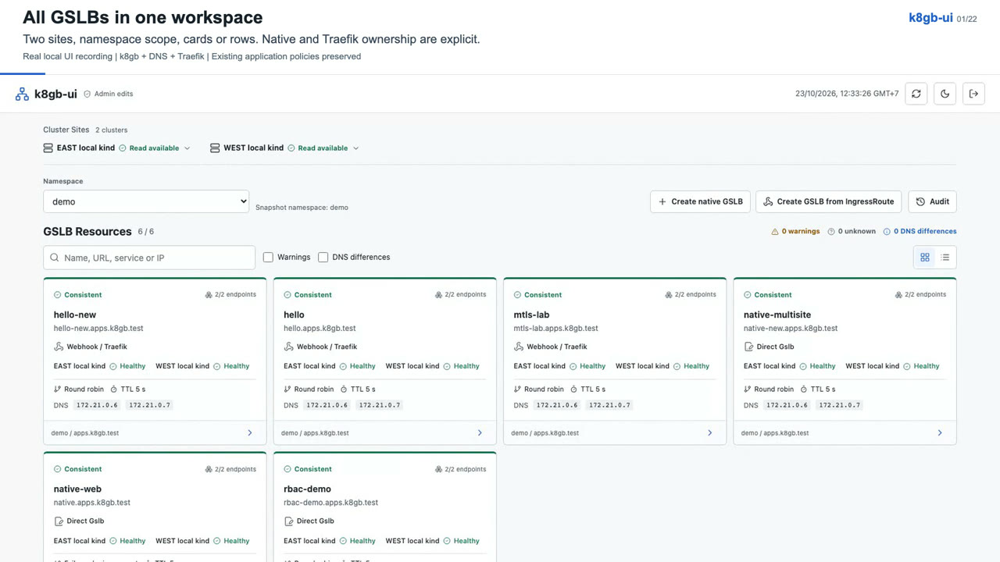
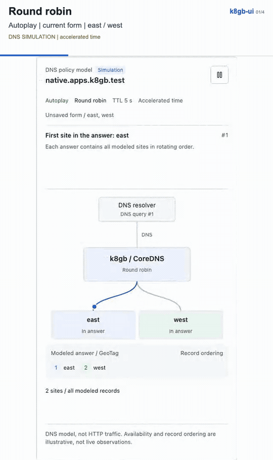

# k8gb-ui

Standalone multi-cluster console for k8gb, read-only by default. Manage native
Gslb resources or use the optional Traefik IngressRoute adapter.
An independent project, not an official k8gb component. The initial 0.1.0 release
is a preview; review the deployment boundaries below before enabling writes.

## Demo

A two-site tour with real k8gb, DNS and Traefik:

- Create and manage native Gslbs or use the optional IngressRoute webhook.
- Preview changes across clusters, exclude and restore sites, override and reset IPs.
- Configure mTLS and DNS SAN authorization, scope access with RBAC, and inspect audit history.

[](docs/media/k8gb-ui-demo.mp4)

[Watch the full demo](docs/media/k8gb-ui-demo.mp4) (2:40, 1080p, English captions, no audio)
or browse the [chapter list](docs/media/chapters.md).

<details>
<summary>DNS policy animation: round robin, weights, failover and GeoIP</summary>



Illustrative models respond to the current form; they are not live traffic telemetry.
The full demo also includes real DNS, certificate and access-control checks.

</details>

## Deployment

See the [Helm chart and profiles](charts/k8gb-ui/README.md) for installation.
Images use one Docker Hub repository, `steemax/k8gb-ui`, with component tags:

| Component | Image |
| --- | --- |
| Console | `steemax/k8gb-ui:0.1.0-console` |
| Site agent | `steemax/k8gb-ui:0.1.0-agent` |
| Optional webhook | `steemax/k8gb-ui:0.1.0-webhook` |

Publish the images before installing the corresponding chart version. The
[release guide](docs/releases.md) covers local builds, Docker Hub and the
GitHub Pages chart repository. For an isolated end-to-end environment, use the
[two-site DNS/auth lab](tests/dns-lab/README.md).

## Features

- Independent Console and per-cluster `gslb-info` agent binaries.
- Kubernetes resources are the source of truth; no database or Git credentials.
- Native Gslb resources, without Traefik or a custom admission webhook.
- Compact cards and rows, search, namespace selection, per-cluster details,
  policy comparison, informational DNS-count differences and DNS animation.
- Explicit cluster/zone/GeoTag registry; no infrastructure-specific hostnames,
  public IP mapping, namespace-owner rules or external asset/CDN dependency.
- Generic OIDC or built-in password accounts with shared cluster/namespace access bindings; read-only
  Kubernetes RBAC by default.
- Opt-in administrator plan/apply for native Gslb creation and policy updates;
  separate read/write credentials, Kubernetes dry-run, signed expiring plans,
  UID/RV checks, structured stdout audit and bounded recent history.
- Optional Traefik adapter: enable/update/deactivate GSLB on an IngressRoute,
  side-effect-free admission and reconciliation after the source route commits.
- Operational traffic API: reversible per-Gslb exposed-IP overrides, plus
  exclude/include of an adapter-owned global site without deleting its GSLB.
- Separately enabled native Ingress exclusion with explicit local-routing impact
  consent and snapshot-guarded restoration; no duplicate-host companion Ingress.
- Explicit Direct Gslb / Webhook-Traefik management labels and write targets in
  cards, rows and per-site details, including mixed ownership across sites.
- Federated on-demand audit from all authorized cluster agents, stable event IDs
  and explicit source availability. Optional namespace-local ConfigMap history
  shares a 700 KiB retained window across agent replicas. See
  [audit topology](docs/audit-topology.md) for retention and multi-cluster limits.
- Multi-cluster native/webhook creation with explicit target selection and an
  autoplay DNS diagram driven by the current unsaved form.

## Local demo

Requires Go 1.26.10 or newer. No Kubernetes connection, credentials, Node build or
external service is needed.

Use a patched, supported Go toolchain. Docker builds pin Go 1.26.10 and the
nonroot runtime by image digest. See the [security policy](SECURITY.md) for
verification commands, deployment boundaries and the unused OpenPGP advisory.

```sh
go run ./cmd/console --demo
```

Open <http://127.0.0.1:8080>. Demo data is explicitly marked and uses reserved
example names and addresses. Local unauthenticated mode refuses non-loopback
listen addresses. Light theme is the default until a user selects another theme.

## Connect a cluster locally

Use an explicit, appropriately restricted kubeconfig. The agent does not read
the workstation's default context implicitly:

```sh
go run ./cmd/agent --cluster-id=east --kubeconfig=/path/to/kubeconfig --allowed-namespaces=demo --insecure-local
go run ./cmd/console --config=examples/console.local.yaml
```

Run these commands in separate terminals. Adjust the configured zone and GeoTag
to those actually served by your k8gb installation. This project never installs
or modifies k8gb or its resources during startup.

## Authenticated deployment

Choose OIDC (`examples/console.oidc.yaml`) or standalone password accounts
(`examples/console.builtin.yaml`). Both use explicit `viewer`/`admin` bindings
and deny access by default. There is no external identity dependency in built-in
mode, no shared default password, and no anonymous public mode. See
[authentication and Keycloak setup](docs/authentication.md) for group mappers,
Argon2id password generation, Secret mounting and replica configuration.

For OIDC, provide secrets as mounted files,
register `/auth/callback` with the identity provider and terminate HTTPS at the
Console ingress. Access is denied unless a subject/group matches an explicit
cluster/namespace binding. Group matching uses the configured top-level claim;
identity uses the OIDC subject, not an email or a caller-supplied header. Keycloak
administrator roles do not implicitly grant application access.

Each agent requires its own bearer token (32..4096 non-whitespace bytes).
Terminate HTTPS at its ingress/proxy; optionally enforce client certificates
there and configure `clientCertFile`/`clientKeyFile` in Console. Server certificate
verification is never disabled. Restart after changing agent credential files.

The agent's HTTP listener is intended behind that trusted TLS boundary; do not
expose its plaintext port publicly. Restrict inbound network access to Console.
An agent token authorizes the agent's configured namespace scope; it is a
service credential, not a Kubernetes end-user identity.

`deploy/agent-rbac.yaml` is a cluster-wide **read-only** example. For namespace
isolation use `--allowed-namespaces` plus namespace Roles/RoleBindings instead
of the ClusterRoleBinding. No Secrets, pod logs, writes or cluster-admin access
are required. `deploy/agent.yaml` needs the agent image and a separately
provided Secret. It does not create an ingress, certificates or credentials.

Creation discovers DNS zones from the configured k8gb controller Deployment
(`--k8gb-namespace=k8gb --k8gb-deployment=k8gb`, optional `--k8gb-container`).
Apply `deploy/agent-dns-zones-rbac.yaml`, adjusted for that locator, to grant
GET on only this Deployment. The agent reads literal `DNS_ZONES` (the second
colon-separated field), or legacy `EDGE_DNS_ZONE` / `DNS_ZONE`; it never reads
Secrets or resolves `envFrom` / `valueFrom`. Unavailable discovery blocks creation,
not existing-object policy edits. See [DNS zone selection](docs/mutations.md#dns-zone-selection).

## Build and verify

```sh
make build
make test
go vet ./...
go mod verify
make images VERSION=0.1.0
make chart
```

The frontend is embedded into Console and uses vendored Lucide icons. Optional
browser checks use `tests/browser.cjs` with Playwright installed separately;
see that file for invocation. No runtime npm dependency is required.

Run the pinned official vulnerability scanner with the same patched Go toolchain
(no global scanner installation is required):

```sh
make vulncheck
```

Release binaries retain a symbol table (without DWARF) for precise
`govulncheck -mode binary` inspection. A module-only scan still reports the
unused, unmaintained OpenPGP package within `x/crypto`; it is not imported by
this application. Do not treat a SARIF export's exit status as a clean gate.

## Optional writes and webhook

Existing configurations and `--demo` stay read-only. To enable writes, configure
both the agent and Console explicitly, including `role: admin` access bindings
and separate write credentials. See [mutation setup and API](docs/mutations.md)
and `examples/console.writes.yaml`. There is no automatic write-RBAC or webhook
installation. No component requires Git credentials or a desired-state database.

Build the optional webhook with `go build -o bin/webhook ./cmd/webhook`, or use
the Dockerfile with `--build-arg COMPONENT=webhook`. The native provider works
without this component. Traefik mTLS uses approved entrypoints and existing
TLSOptions; optional DNS SAN filtering requires separately installed certauthz.
No private TLSOption, CA, plugin alias or namespace naming scheme is assumed.
See [Traefik mTLS configuration](docs/traefik-mtls.md).

## Boundaries and next stages

The read API is `k8gb-ui/v1alpha1`, an internal experimental contract. Native
schema handling is covered by fixture tests and opt-in local Kubernetes API
acceptance tests. A full k8gb/DNS release matrix still needs separate runs. The
[two-cluster DNS lab](tests/dns-lab/README.md) exercises real round-robin DNS
withdrawal/return and IP override/reset against pinned k8gb v1.0.0. See
[architecture](docs/architecture.md).

Policy can be copied to selected observed native Gslbs, with independent plans
and results per cluster. Native deletion, automatic ownership migration, external
audit archival integration and a full compatibility matrix remain future work.
The [Helm chart](charts/k8gb-ui/README.md) includes builtin/OIDC,
read-only/writer agents and an optional webhook. It has render/lint tests and a
local two-cluster install/upgrade harness, not a production support guarantee.
Native and generated Gslbs support IP override and safe reset. Native site exclusion
needs a separate agent flag and namespace-scoped RBAC: unlike adapter global-route exclusion, it stops local
Ingress routing too. See [mutation safety and setup](docs/mutations.md).
The adapter preserves operational overrides during reconciliation.
Console being read-only does not revoke writes performed by other tools.

## License

Licensed under [Apache-2.0](LICENSE). Third-party components retain their own
licenses; the bundled [Lucide notice](web/static/vendor/lucide.LICENSE) is preserved.
